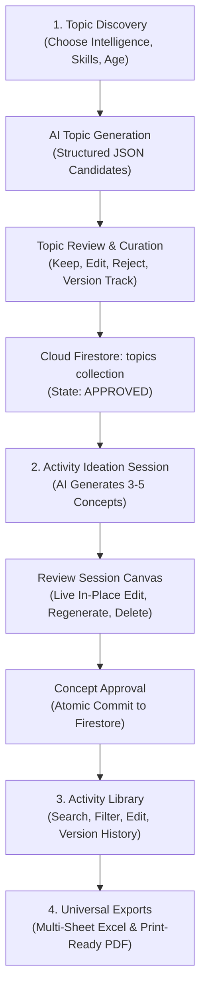

# Octa AI Activity Generation Platform

> **Production-Grade Pedagogical Activity Generation, Taxonomy Mapping, and Curriculum Blueprint Engine for Octa Kids**

[](https://nextjs.org/)
[](https://react.dev/)
[](https://fastapi.tiangolo.com/)
[](https://python.org/)
[](https://cloud.google.com/firestore)
[](http://localhost:8000/docs)
[]()

---

## Table of Contents

1. [Executive Overview & Pedagogical Mission](#1-executive-overview--pedagogical-mission)
2. [High-Level Architecture](#2-high-level-architecture)
3. [Strict Architectural Constraints](#3-strict-architectural-constraints)
4. [End-to-End Workflow Pipeline](#4-end-to-end-workflow-pipeline)
   - [Stage 1: Topic Discovery & Taxonomy Mapping](#stage-1-topic-discovery--taxonomy-mapping)
   - [Stage 2: Topic Review, Edit, Approval & Version History](#stage-2-topic-review-edit-approval--version-history)
   - [Stage 3: Activity Ideation & Review Session](#stage-3-activity-ideation--review-session)
   - [Stage 4: Approved Activity Library](#stage-4-approved-activity-library)
   - [Stage 5: Universal Edit, Delete & Version Tracking Engine](#stage-5-universal-edit-delete--version-tracking-engine)
   - [Stage 6: Enterprise Exports (Excel & Print-Perfect PDF Blueprint)](#stage-6-enterprise-exports-excel--print-perfect-pdf-blueprint)
5. [Educational Taxonomy & Cascading Skills System](#5-educational-taxonomy--cascading-skills-system)
6. [Data Modeling & Firestore Schema Architecture](#6-data-modeling--firestore-schema-architecture)
7. [AI Engine & Structured Generation Safety](#7-ai-engine--structured-generation-safety)
8. [Interactive API Documentation (Swagger & ReDoc)](#8-interactive-api-documentation-swagger--redoc)
9. [Complete API Endpoint Catalog](#9-complete-api-endpoint-catalog)
10. [Local Development & Setup Guide](#10-local-development--setup-guide)
11. [Environment Variables Reference](#11-environment-variables-reference)
12. [Production Deployment Guide](#12-production-deployment-guide)
13. [Testing, Linting & Quality Assurance](#13-testing-linting--quality-assurance)

---

## 1. Executive Overview & Pedagogical Mission

The **Octa AI Activity Generation Platform** is a local-first, cloud-backed pedagogical authoring suite created for **Octa Kids**. Its primary purpose is to automate the discovery, curation, validation, ideation, and generation of holistic learning activities for children aged **3 to 18** (spanning **Pre-K through Grade 12**).

### Pedagogical Philosophy: The Octa Framework
Rather than relying on generic, unguided activity prompts, the platform is anchored in evidence-based developmental pedagogy:
- **Howard Gardner's Theory of Multiple Intelligences**: Activities are mapped across 8 primary intelligences (Linguistic, Logical-Mathematical, Spatial, Musical, Bodily-Kinesthetic, Interpersonal, Intrapersonal, Naturalistic).
- **21st-Century Skill Hierarchies**: Over 40 discrete cognitive and practical skills (e.g., Critical Thinking, Design Thinking, Pattern Recognition, Emotional Regulation) broken down into specific developmental sub-skills.
- **Three-Part Curriculum Blueprint (OCTAKIDZ Blueprint)**:
  1. **Part 1: Student & Parent Launchpad (Pre-Activity)**: Concept hooks, age-appropriate warmup discussion starters, Parent's Note, and Parent's Guidance.
  2. **Part 2: Hands-On Action Blueprint (Main & Post-Activity)**: Structured multi-step hands-on activities with embedded data collection tables, reflection questions, level-up challenges, and learning extensions.
  3. **Part 3: Curriculum Standards & Assessment (Metadata)**: Aligned educational taxonomy, learning objectives, required everyday materials, and objective assessment rubrics.

---

## 2. High-Level Architecture

The platform follows a clean, decoupled client-server architecture with strict separation between user experience, business logic, artificial intelligence, and persistence.

```
+-----------------------------------------------------------------------------------+
|                                  USER / BROWSER                                   |
+-----------------------------------------+-----------------------------------------+
                                          |
                                          | HTTP / JSON (REST)
                                          v
+-----------------------------------------------------------------------------------+
|                        FRONTEND: Next.js 16 (App Router)                         |
|  - React 19 + TypeScript + Tailwind CSS                                           |
|  - Topic Discovery & Generation Screen (/topics/generate)                         |
|  - Topic Library & Detailed Curriculum Review (/topics/library, /topics/[id])     |
|  - Activity Ideation & Review Session (/activity-ideation)                        |
|  - Approved Activity Library with Batch Export (/activities/library)              |
|  - Universal Modals: Topic Edit, Activity Edit, Version History                   |
|  - Interactive Print-Perfect A4 PDF Blueprint Engine & Excel Multi-Sheet Exporters|
+-----------------------------------------+-----------------------------------------+
                                          |
                                          | REST API + Basic Auth (Allowed Users)
                                          v
+-----------------------------------------------------------------------------------+
|                            BACKEND: FastAPI (Python 3.12)                         |
|  - Routers: Topics, Topic Review, Activity Ideation, Activities, Health, Auth     |
|  - Business Services: AI Orchestrator, Ideation Session Manager, Export Service   |
|  - Version Tracking Engine: Snapshot Persistence, Field Diffs, Rollbacks          |
|  - In-Memory Transient Review Session Store (LRU 100 sessions, 24h TTL)           |
+-------------------+---------------------+--------------------+--------------------+
                    |                     |                    |
                    v                     v                    v
+-----------------------+ +-----------------------+ +-----------------------+
|  AI PROVIDER ENGINE   | |  FIRESTORE REPOSITORY | |  LOCAL FILE STORAGE   |
| - Gemini 2.5 Flash    | | - Google Cloud        | | - Static PDF exports  |
| - OpenAI Fallback     | |   Firestore DB        | | - Excel files         |
| - Anthropic Fallback  | | - Collections:        | | - App logs            |
| - Strict Pydantic JSON| |   topics, activities, | | - Local cache         |
|   Validation & Retries| |   versions, mappings  | |                       |
+-----------------------+ +-----------------------+ +-----------------------+
```

---

## 3. Strict Architectural Constraints

To maintain extreme reliability, security, and enterprise maintainability, the codebase adheres to strict engineering rules:

| Constraint Category | Strictly Prohibited | Mandatory Architecture |
|---|---|---|
| **Database** | PostgreSQL, MySQL, MongoDB, Prisma, Supabase, SQLite (prod) | **Google Cloud Firestore** is the sole cloud database and single source of truth. |
| **Authentication** | OAuth, JWT, external auth microservices, database auth tables | **Configurable Basic Authentication** via `ALLOWED_USERS` (`admin:admin123`, `editor:editor123`). |
| **AI Generation** | Free-form unvalidated text responses | **Structured Pydantic JSON Schemas** validated before any state transition or persistence. |
| **AI Database Access** | AI directly writing to Firestore or local disk | AI returns validated structured objects to FastAPI services; **backend services persist data**. |
| **Frontend Isolation** | AI prompts or credentials embedded in frontend bundles | Frontend interacts solely via backend REST endpoints; **zero API keys exposed in browser**. |
| **Separation of Concerns**| Database queries inside API routes or business logic in views | Strict separation: **API Routers $\rightarrow$ Services $\rightarrow$ Repositories**. |

---

## 4. End-to-End Workflow Pipeline



---

### Stage 1: Topic Discovery & Taxonomy Mapping
- **Route**: `/topics/generate`
- **User Inputs**:
  - Target Age Range (Slider: 3 to 18 years)
  - Target Grade / Class (Pre-K through Grade 12)
  - Country / Cultural Context (e.g., India, United States, Global)
  - Primary Intelligence focus (or "Any Intelligence" for open discovery)
  - Specific Skills & Sub-Skills (dynamically filtered by selected intelligence)
  - Topic Family (e.g., Everyday Science, Nature & Ecology, Math & Numbers)
  - Keywords / Custom interests
- **AI Processing**:
  - The backend `TopicDiscoveryService` prepares a versioned prompt (`apps/api/prompts/topic_discovery_v1.txt`).
  - Calls `AIProvider` to generate 3 to 10 structured `TopicCandidate` objects.
  - Generates carried-forward mappings (suggested intelligence, suggested skills, suggested sub-skills).
  - Stores candidates in a transient discovery session.

### Stage 2: Topic Review, Edit, Approval & Version History
- **Route**: `/topics/library` and `/topics/[id]`
- **Capabilities**:
  - **Single / Batch Action**: Keep individual topics or "Keep All".
  - **Universal Edit**: Edit topic title, description, age range, grade, country context, keywords, and rationale.
  - **Automatic Version Tracking**: The system creates a baseline Version 1 snapshot. Every subsequent edit creates an immutable `TopicVersion` snapshot with detailed field-level diffs (`old_value`, `new_value`).
  - **Version History Modal**: Users can view the chronological audit log of all changes and click **"Restore This Version"** to roll back to any historical snapshot.
  - **Delete**: Safely delete unwanted topics and their associated skill mappings.
  - **Approval**: Transition topic state from `DRAFT` $\rightarrow$ `APPROVED`. Only `APPROVED` topics flow into Activity Ideation.

### Stage 3: Activity Ideation & Review Session
- **Route**: `/activity-ideation`
- **Session Lifecycle**:
  - Select an approved topic from the dropdown.
  - Request 1 to 5 activity concepts (default: 3 concepts).
  - The AI generates full OCTAKIDZ activity blueprints matching the carried-forward topic taxonomy.
  - Concepts are stored in an in-memory thread-safe `ReviewSessionStore` (with 24-hour TTL and 100-session LRU capacity).
- **In-Session Operations**:
  - **Interactive Editing**: Click **"Edit Parameters"** to modify title, duration, pre-activity, main steps, reflection questions, level-up challenges, or educational metadata.
  - **Section Regeneration**: Regenerate only the Pre-Activity, Main Activity, or Post-Activity section without re-rolling the rest.
  - **Full Regeneration**: Re-prompt AI to regenerate an entire concept from scratch.
  - **Delete Concept**: Delete unwanted draft concepts from the session canvas.
  - **Approve Concept**: Commits the concept atomically into Cloud Firestore as an approved `Activity` record.

### Stage 4: Approved Activity Library
- **Route**: `/activities/library`
- **Features**:
  - Full-text search by title, topic, intelligence, skill, or learning objective.
  - Multi-attribute filtering: by Intelligence, Age group, Topic Family, Country context.
  - **Card & Detailed Views**: Toggle between compact summary cards and expanded 3-section curriculum views.
  - **Batch Selection**: Select multiple activities (up to 50) for batch Excel or PDF export.
  - **Universal Edit & Delete**: Edit any approved activity in-place or permanently delete it.
  - **Version History & Rollback**: Complete version auditing identical to topics.

---

### Stage 5: Universal Edit, Delete & Version Tracking Engine

The platform features an automated, non-destructive versioning engine across all primary entities:

```
[User Action: Edit Topic or Activity]
               |
               v
  Check if v1 Baseline Exists
     ├── NO  ──> Create v1 Snapshot of Original Record in Firestore
     └── YES ──> Proceed
               |
               v
  Calculate Field-Level Diffs (Old Value vs New Value)
               |
               v
  Commit New Version Snapshot (v2, v3, ...) to *_versions Collection
               |
               v
  Update Primary Document in topics or activities Collection
```

- **Version History Modal**:
  - Displays version badge (e.g., `v2`, `v3`), timestamp, editor (`admin`, `editor`, `ai`), and change summary.
  - Expanding a version displays an interactive diff table showing exactly which fields were changed, the previous value, and the new value.
  - **One-Click Rollback**: Clicking **"Restore This Version"** restores the target snapshot as the active record and creates a new rollback audit entry.

---

### Stage 6: Enterprise Exports (Excel & Print-Perfect PDF Blueprint)

#### 1. Multi-Sheet Excel Workbooks (`.xlsx`)
- Generated using Python's `openpyxl` library with custom pedagogical styling:
  - **Sheet 1: Activity Overview**: Complete metadata, duration, age, grade, country, and carried-forward mappings.
  - **Sheet 2: Pre-Activity**: Hook, Parent's Note, Parent's Guide, warm-up starters, and rationale.
  - **Sheet 3: Main Activity**: Step-by-step instructions, embedded data recording tables, and reflection prompts.
  - **Sheet 4: Post-Activity**: What's next, level-up challenges, learning extensions, and post-activity summary.
  - **Sheet 5: Educational Metadata**: Learning objectives, required materials, assessment criteria, and difficulty.
- **Batch Export**: Automatically exports up to 50 activities into a consolidated multi-sheet workbook.

#### 2. Print-Perfect A4 PDF Curriculum Blueprints
- Designed to replicate high-end published educational workbooks and teacher lesson plans:
  - **Live Screen Preview Toolbar**: Fixed top bar with OCTAKIDS branding, activity title, **"Print / Save as PDF"** button, and **"Close"** button.
  - **Page-Perfect A4 Containers**: Rendered at exact international A4 dimensions (`210mm × 297mm`) with soft background framing on screen.
  - **Color-Coded Educational Sections**:
    - *Page 1: Student & Parent Launchpad* (Deep Indigo `#5B50F5` & Cyan `#0284c7`)
    - *Page 2: Hands-On Action Blueprint* (Emerald `#059669` & Amber `#d97706`)
    - *Page 3: Curriculum Standards & Assessment* (Purple `#7c3aed` & Rose `#e11d48`)
  - **Print Engine Fidelity**:
    - `@page { size: A4 portrait; margin: 0; }`
    - Exact page breaks (`page-break-after: always; break-after: page;`)
    - Color fidelity enforcement (`-webkit-print-color-adjust: exact; print-color-adjust: exact;`)
    - Lined facilitator observation notes section for teacher/parent handwritten notes.

---

## 5. Educational Taxonomy & Cascading Skills System

The platform enforces a strict hierarchical relationship between Multiple Intelligences, Skills, and Sub-Skills:

```
Multiple Intelligence (e.g. Logical-Mathematical)
  └── Skill (e.g. Computational Thinking)
        └── Sub-Skill (e.g. Pattern Recognition, Algorithmic Thinking)
```

### Cascading Dropdown Behavior
- When a user selects an **Intelligence** in Topic Discovery:
  - The **Skills** dropdown is filtered in real time to show *only* skills belonging to that intelligence.
  - The **Sub-Skills** dropdown is filtered to show *only* sub-skills belonging to the selected skills.
- If the user selects "Any Intelligence", all skills and sub-skills are available for open, interdisciplinary discovery.

### Master Intelligence Taxonomy Reference
1. **Linguistic Intelligence**: Storytelling, Vocabulary Expansion, Creative Writing, Public Speaking.
2. **Logical-Mathematical Intelligence**: Computational Thinking, Problem Solving, Quantitative Reasoning, Scientific Inquiry.
3. **Spatial Intelligence**: Visual Mapping, 3D Visualization, Design Thinking, Pattern Geometry.
4. **Musical Intelligence**: Rhythm & Beat, Auditory Discrimination, Melody Construction, Acoustic Patterns.
5. **Bodily-Kinesthetic Intelligence**: Fine Motor Coordination, Gross Motor Agility, Physical Roleplay, Spatial Navigation.
6. **Interpersonal Intelligence**: Collaborative Problem Solving, Empathy & Active Listening, Negotiation, Leadership.
7. **Intrapersonal Intelligence**: Self-Reflection, Emotional Regulation, Goal Setting, Mindfulness.
8. **Naturalistic Intelligence**: Environmental Observation, Biological Classification, Ecological Stewardship, Field Research.

---

## 6. Data Modeling & Firestore Schema Architecture

Google Cloud Firestore is the primary cloud database and source of truth. All documents are validated against strict Pydantic models in `apps/api/models/domain.py`.

### Firestore Collections

| Collection Name | Document ID | Purpose | Key Attributes |
|---|---|---|---|
| `topics` | UUID string | Canonical discovered topics | `topic`, `topic_family_name`, `age_min`, `age_max`, `target_class`, `country_context`, `state` (`DRAFT`, `APPROVED`, `REJECTED`), `created_by`, `created_at` |
| `topic_versions` | Auto / UUID | Immutable topic version history | `topic_id`, `version_number`, `snapshot` (full JSON), `diffs` (list of changes), `edited_by`, `created_at` |
| `activity_concepts` | UUID string | Generated review session concepts | `concept_id`, `topic_id`, `title`, `duration`, `pre_activity`, `main_activity`, `post_activity`, `state` |
| `activities` | UUID string | Approved, finalized activities | `activity_id`, `topic_id`, `concept_id`, `activity_name`, `estimated_duration`, `pre_activity`, `main_activity`, `post_activity`, `learning_objective`, `materials`, `state` (`APPROVED`) |
| `activity_versions` | Auto / UUID | Immutable activity version history | `activity_id`, `version_number`, `snapshot` (full JSON), `diffs` (list of changes), `edited_by`, `created_at` |
| `activity_skill_mappings` | Auto / UUID | Relationship between activities and taxonomy | `activity_id`, `intelligence_id`, `skill_id`, `sub_skill_id`, `is_primary` |
| `topic_skill_mappings` | Auto / UUID | Relationship between topics and taxonomy | `topic_id`, `intelligence_id`, `skill_id`, `sub_skill_id` |
| `master_intelligences` | Slug / Code | Master list of 8 intelligences | `intelligence_id`, `name`, `description` |
| `master_skills` | Slug / Code | Master list of 40+ skills | `skill_id`, `intelligence_id`, `name`, `description` |
| `master_subskills` | Slug / Code | Master list of 100+ sub-skills | `sub_skill_id`, `skill_id`, `name`, `description` |
| `master_topic_families` | Slug / Code | Master list of topic families | `family_id`, `name`, `description` |

---

## 7. AI Engine & Structured Generation Safety

The platform implements a multi-tier AI execution architecture designed to eliminate hallucinations and schema violations:

1. **Provider Abstraction (`AIProvider`)**:
   - `GeminiProvider`: Primary model (Gemini 2.5 Flash) optimized for low latency, high pedagogical reasoning, and native structured JSON outputs.
   - `OpenAIProvider`: Configurable fallback provider (GPT-4o / GPT-4o-mini).
   - `AnthropicProvider`: Optional secondary fallback (Claude 3.5 Sonnet).
2. **Schema Enforcement**:
   - AI outputs are requested strictly as JSON conforming to Pydantic schemas (`TopicDiscoveryResult`, `ActivityIdeationResult`).
   - Responses undergo multi-stage validation: raw JSON parse $\rightarrow$ Pydantic model validation $\rightarrow$ pedagogical constraint verification.
   - If validation fails, the engine retries up to 3 times with exponential backoff and jitter.
3. **Session Store Isolation**:
   - AI generates temporary concept drafts in memory.
   - AI code **never** has direct write access to Firestore. Persistence occurs only when a human user clicks "Approve".

---

## 8. Interactive API Documentation (Swagger & ReDoc)

FastAPI automatically serves interactive, self-documenting OpenAPI specifications for developers and QA engineers:

- **Swagger UI**: [http://localhost:8000/docs](http://localhost:8000/docs)
  - Interactive "Try it out" testing for all endpoints.
  - Built-in Basic Authentication dialog (enter `admin` / `admin123`).
  - Visual request and response schema inspectors.
- **ReDoc**: [http://localhost:8000/redoc](http://localhost:8000/redoc)
  - Clean, reader-friendly documentation layout.
  - Complete nested schema models and payload examples.
- **Raw OpenAPI Specification**: [http://localhost:8000/openapi.json](http://localhost:8000/openapi.json)
  - Full OpenAPI 3.1 JSON specification for Postman collections or client SDK generation.

> **Production Note**: On Render deployments, Swagger UI is live at:  
> `https://<your-render-app>.onrender.com/docs`

---

## 9. Complete API Endpoint Catalog

### System & Health Endpoints
| Method | Endpoint | Description | Auth Required |
|---|---|---|---|
| `GET` | `/health` | Application health and Firestore connectivity check | Public |
| `GET` | `/api/health` | API subsystem status and Firestore ping | Public |
| `GET` | `/api/ai/models` | List available AI providers and model IDs | Public |
| `GET` | `/api/master-data` | Master list of Intelligences, Skills, Sub-Skills, and Families | Public |

### Topic Discovery & Management
| Method | Endpoint | Description | Auth Required |
|---|---|---|---|
| `POST` | `/api/topics/discover` | Discover new topic candidates using AI | Required |
| `GET` | `/api/topics` | List and filter discovered topics (`state`, `family`, `search`) | Required |
| `GET` | `/api/topics/{topic_id}` | Retrieve single topic with skill mappings and state | Required |
| `PATCH` | `/api/topics/{topic_id}` | Edit topic fields (creates immutable version snapshot) | Required |
| `DELETE` | `/api/topics/{topic_id}` | Delete topic and associated skill mappings | Required |
| `POST` | `/api/topics/{topic_id}/approve` | Approve topic for activity generation | Required |
| `POST` | `/api/topics/{topic_id}/reject` | Reject topic | Required |
| `GET` | `/api/topics/{topic_id}/versions` | Retrieve version history and change diffs | Required |
| `POST` | `/api/topics/{topic_id}/restore/{v}` | Restore topic to a previous historical version snapshot | Required |

### Activity Ideation & Review Session
| Method | Endpoint | Description | Auth Required |
|---|---|---|---|
| `GET` | `/api/activity-ideation/topics` | List approved topics eligible for activity generation | Required |
| `POST` | `/api/activity-ideation/generate` | Generate AI activity concepts for an approved topic | Required |
| `GET` | `/api/activity-ideation/sessions/{id}` | Retrieve review session by session ID | Required |
| `PATCH` | `/api/activity-ideation/sessions/{id}/concepts/{cid}` | Edit concept parameters in-place | Required |
| `DELETE` | `/api/activity-ideation/sessions/{id}/concepts/{cid}` | Delete concept from review session | Required |
| `POST` | `/api/activity-ideation/sessions/{id}/concepts/{cid}/regenerate` | Fully regenerate a single concept | Required |
| `POST` | `/api/activity-ideation/sessions/{id}/concepts/{cid}/regenerate-section` | Regenerate specific section (Pre, Main, Post) | Required |
| `POST` | `/api/activity-ideation/sessions/{id}/concepts/{cid}/approve` | Atomically commit concept into Activity Library | Required |
| `POST` | `/api/activity-ideation/sessions/{id}/concepts/{cid}/reject` | Reject concept | Required |

### Activity Library & Versioning
| Method | Endpoint | Description | Auth Required |
|---|---|---|---|
| `GET` | `/api/activities` | List, search, and filter approved activities | Required |
| `GET` | `/api/activities/{activity_id}` | Get single activity details, sections, and metadata | Required |
| `PATCH` | `/api/activities/{activity_id}` | Edit activity fields (creates immutable version snapshot) | Required |
| `DELETE` | `/api/activities/{activity_id}` | Delete activity and associated records | Required |
| `GET` | `/api/activities/{activity_id}/versions` | Retrieve activity version history and change diffs | Required |
| `POST` | `/api/activities/{activity_id}/restore/{v}`| Restore activity to a previous historical version snapshot | Required |

### Exports (Excel & PDF)
| Method | Endpoint | Description | Auth Required |
|---|---|---|---|
| `POST` | `/api/activities/export/excel` | Export single activity as formatted `.xlsx` workbook | Required |
| `POST` | `/api/activities/export/excel/batch` | Export batch of activities as consolidated `.xlsx` | Required |
| `GET` | `/api/activities/{id}/export/excel` | Direct download single activity Excel file | Required |

---

## 10. Local Development & Setup Guide

### Prerequisites
- **Node.js**: `v20.x` or `v22.x` (LTS recommended)
- **Python**: `3.10`, `3.11`, or `3.12`
- **Google Cloud Platform Project**: Firestore database enabled with service account credentials (`data/firebase-key.json`).

### One-Command Startup
The project includes an automated startup script that installs dependencies, validates the environment, and launches both services:

```bash
# Standard launch (Backend on :8000, Frontend on :3000)
./start.sh

# Optional: Run full build and initialize Firestore master data
./start.sh --build
```

---

### Manual Setup (Step-by-Step)

#### 1. Backend Setup (FastAPI)
```bash
# Navigate to API directory
cd apps/api

# Create and activate virtual environment
python3 -m venv venv
source venv/bin/activate

# Install dependencies
pip install -r requirements.txt

# Initialize Master Data in Google Cloud Firestore
PYTHONPATH=../../ python scripts/init_master_data.py

# Launch FastAPI development server
uvicorn apps.api.main:app --host 0.0.0.0 --port 8000 --reload
```

#### 2. Frontend Setup (Next.js)
```bash
# In a new terminal, navigate to web directory
cd apps/web

# Install npm dependencies
npm install

# Launch Next.js development server
npm run dev
```

Visit [http://localhost:3000](http://localhost:3000) in your browser.

---

## 11. Environment Variables Reference

### Backend (`apps/api/.env`)
```bash
# Environment Mode
ENVIRONMENT=development
PORT=8000

# Google Cloud Firestore
GOOGLE_APPLICATION_CREDENTIALS=../../data/firebase-key.json
GCP_PROJECT_ID=octa-ai-activities-generator

# AI Configuration
DEFAULT_AI_PROVIDER=gemini
GEMINI_API_KEY=your_gemini_api_key_here
OPENAI_API_KEY=your_openai_api_key_here          # Optional fallback
ANTHROPIC_API_KEY=your_anthropic_api_key_here    # Optional fallback

# Basic Authentication (comma-separated username:password pairs)
ALLOWED_USERS=admin:admin123,editor:editor123

# CORS Configuration
FRONTEND_URL=http://localhost:3000
```

### Frontend (`apps/web/.env.local`)
```bash
# Backend REST API URL
NEXT_PUBLIC_API_URL=http://localhost:8000

# Base Path (leave empty for local dev; used for GitHub Pages)
NEXT_PUBLIC_BASE_PATH=
```

---

## 12. Production Deployment Guide

### Architecture Overview
- **Frontend**: Static export hosted on **GitHub Pages** via `.github/workflows/nextjs.yml`.
- **Backend**: Containerized web service hosted on **Render** using `render.yaml`.
- **Database**: Managed **Google Cloud Firestore** (`octa-ai-activities-generator`).

### 1. Backend Deployment (Render)
1. Fork or push the repository to GitHub.
2. In Render, create a new **Blueprint** and select this repository.
3. Configure the following environment variables in the Render Dashboard:
   - `ENVIRONMENT`: `production`
   - `GCP_PROJECT_ID`: `octa-ai-activities-generator`
   - `FIREBASE_KEY_JSON`: *(Paste the complete JSON content of your GCP service account key)*
   - `GEMINI_API_KEY`: *(Your Google AI Studio API key)*
   - `ALLOWED_USERS`: `admin:SecureProductionPassword1!,editor:SecureProductionPassword2!`
   - `FRONTEND_URL`: `https://<your-username>.github.io`
4. Deploy the service. Render will start the FastAPI backend with Uvicorn.

### 2. Frontend Deployment (GitHub Pages)
1. In your GitHub repository settings, navigate to **Settings $\rightarrow$ Pages**.
2. Set **Source** to **GitHub Actions**.
3. Under **Settings $\rightarrow$ Secrets and variables $\rightarrow$ Actions**:
   - Variable `NEXT_PUBLIC_API_URL`: Set to your Render backend URL (e.g., `https://octa-activity-api.onrender.com`).
4. Push to the `main` branch. The `.github/workflows/nextjs.yml` workflow will automatically build, export, and publish the static Next.js frontend to GitHub Pages.

### 3. Firestore Backup & Disaster Recovery
- **Point-in-Time Recovery (PITR)**: Enable PITR on the production Firestore instance for 7 to 14-day continuous rewind protection:
  ```bash
  gcloud firestore databases update --database='(default)' --enable-pitr
  ```
- **Automated Daily Backups**: Create a daily backup schedule retaining backups for 14 days:
  ```bash
  gcloud firestore backups schedules create --database='(default)' --recurrence=daily --retention=14d
  ```

---

## 13. Testing, Linting & Quality Assurance

The codebase includes an automated test suite and strict type-checking verification:

### Run Backend Tests (Pytest)
```bash
cd apps/api
PYTHONPATH=../../ pytest -v tests/
```
*Current test suite: **74 passing tests** verifying Firestore persistence, domain models, version tracking, edit diffs, rollbacks, cascade deletions, AI retry fallbacks, and Excel/PDF exporters.*

### Run Type Checking & Linting
```bash
# Frontend TypeScript check
cd apps/web && npx tsc --noEmit

# Frontend ESLint check
cd apps/web && npm run lint

# Frontend Production Build verification
cd apps/web && npm run build

# Backend static analysis
cd apps/api && PYTHONPATH=../../ mypy --ignore-missing-imports main.py
```

---

## License & Copyright

Copyright © 2026 **Octa Kids** / **Octa AI Activity Platform**. All rights reserved.  
*Proprietary and confidential educational software.*
